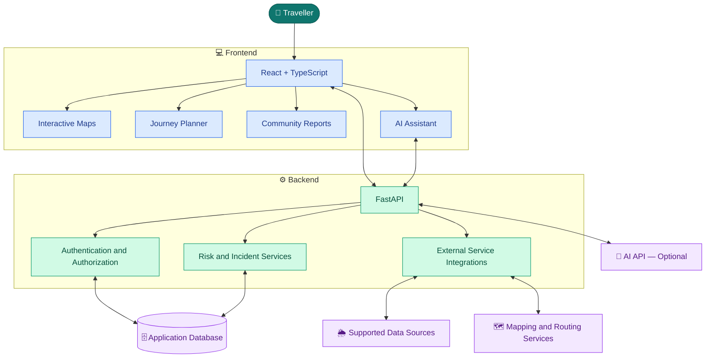

<div align="center">


<br/>

### 🌍 Know the Risks. Plan Your Journey. Travel with Awareness.

**An AI-assisted travel-risk awareness platform built for informed journeys across India.**

</div>


<br/>

<a href="https://github.com/devakashlakshmanan/TravelLordAI-2026">
  
</a>
<a href="#-installation">
  
</a>
<a href="#-system-architecture">
  
</a>

<br/><br/>


<br/>

<i>Helping people make more informed travel decisions through accessible risk information.</i>

</div>

---

## 🧭 Explore TravelLord AI

<table>
<tr>
<td align="center" width="33%">
<a href="#-about-the-project">

<br/><b>🌍 About</b>
</a>
<br/><sub>Vision and problem statement</sub>
</td>
<td align="center" width="33%">
<a href="#-key-features">

<br/><b>✨ Features</b>
</a>
<br/><sub>Explore platform capabilities</sub>
</td>
<td align="center" width="33%">
<a href="#-system-architecture">

<br/><b>🏗️ Architecture</b>
</a>
<br/><sub>Understand the system</sub>
</td>
</tr>
<tr>
<td align="center">
<a href="#-technology-stack">

<br/><b>🛠️ Technology</b>
</a>
<br/><sub>Tools and frameworks</sub>
</td>
<td align="center">
<a href="#-installation">

<br/><b>⚙️ Installation</b>
</a>
<br/><sub>Run the project locally</sub>
</td>
<td align="center">
<a href="#-testing">

<br/><b>🧪 Testing</b>
</a>
<br/><sub>Validate functionality</sub>
</td>
</tr>
</table>

---

## 🌟 About the Project

**TravelLord AI** is a traveller-oriented risk-awareness platform that brings relevant travel information into one accessible interface.

Information about flooding, landslides, road disruptions, wildlife-related incidents, accidents, and local disturbances may be spread across different services and communities. Travellers can find it difficult to identify which information is relevant to a particular location or journey.

TravelLord AI aims to simplify this process by combining:

- 🗺️ Interactive maps and journey planning
- ⚠️ Location-based risk and incident information
- 🌦️ Available weather information and official alerts
- 👥 Community-contributed hazard reports
- 🤖 AI-assisted explanations and travel-awareness guidance
- 🛡️ Source transparency and report-status information

<div align="center">

### 🎯 Our Mission

**Make travel-risk information easier to discover, understand, and share.**

</div>

> ⚠️ TravelLord AI is an awareness tool. It does not guarantee a safe journey, independently verify every report, or replace official emergency instructions.

---

## ❗ The Problem We Address

<table>
<tr>
<th align="center">Challenge</th>
<th>Why It Matters</th>
<th>Our Approach</th>
</tr>
<tr>
<td align="center">🌧️ Scattered information</td>
<td>Relevant warnings may be spread across multiple sources.</td>
<td>Bring supported information into a unified interface.</td>
</tr>
<tr>
<td align="center">🛣️ Route uncertainty</td>
<td>Travellers may not know about reported hazards along their route.</td>
<td>Present available route-related risk information.</td>
</tr>
<tr>
<td align="center">📍 Unfamiliar locations</td>
<td>Local conditions can be difficult for visitors and regular travellers to discover.</td>
<td>Support location-based incident discovery.</td>
</tr>
<tr>
<td align="center">👥 Limited information sharing</td>
<td>Useful local observations may not reach other travellers.</td>
<td>Provide community hazard-reporting capabilities.</td>
</tr>
<tr>
<td align="center">🧠 Difficult information</td>
<td>Warnings and incident details may be hard to interpret.</td>
<td>Offer AI-assisted explanations using available context.</td>
</tr>
</table>

---

## 💎 Key Features

<table>
<tr>
<td width="50%" valign="top">

### 🗺️ Journey Planner

Explore journeys and review available route-related information.

- Route visualization on interactive maps
- Journey origin and destination selection
- Available hazard and incident context
- Saved journey capabilities where implemented

</td>
<td width="50%" valign="top">

### ⚠️ Threat Centre

Explore reported hazards and relevant incident information.

- Geotechnical hazards
- Wildlife-related incidents
- Road disruptions and accidents
- Social and local disturbances
- Available source and timestamp details

</td>
</tr>
<tr>
<td width="50%" valign="top">

### 👥 Community Reports

Share local observations that may help other travellers.

- Submit hazard information
- Associate reports with locations
- Track personal contributions
- Support report review and verification workflows

</td>
<td width="50%" valign="top">

### 🌦️ Official Alerts

Access information from supported external sources.

- Available weather information
- Official alerts where integrated
- Road and traffic information where supported
- Source and freshness awareness

</td>
</tr>
<tr>
<td width="50%" valign="top">

### 🤖 AI Travel Assistant

Make available information easier to understand.

- Explain hazard categories
- Answer travel-awareness questions
- Help interpret available journey information
- Provide contextual assistance when configured

</td>
<td width="50%" valign="top">

### 🛡️ Trust and Safety

Promote responsible use of risk information.

- Source transparency
- Report-status awareness
- User account and access controls
- Emergency guidance and safety resources

</td>
</tr>
</table>

<details>
<summary><b>🔎 Explore additional platform modules</b></summary>

Depending on the modules enabled in the application, TravelLord AI may also provide:

- 🔔 Notifications
- 🎒 Travel Pack
- 🧭 Discover
- 📚 Hazard Guide
- 🚨 Emergency Guide
- 📡 Source Centre
- 📰 Live Reports
- 👤 User Profile and Preferences
- 🛠️ Administration Portal
- 💬 Support interface

The availability and behavior of each module depend on the current implementation and configuration.

</details>

---

## 🧠 AI Innovation

TravelLord AI focuses on using AI to make available information easier to understand.

<div align="center">

| Capability | Purpose |
|:---|:---|
| 🧩 Context-aware assistance | Help interpret information available through the platform |
| 💬 Natural-language explanations | Make complex details easier to understand |
| 📍 Travel-focused responses | Organize information around locations and journeys |
| 🔎 Evidence-aware communication | Communicate uncertainty and information limitations |

</div>

### Responsible AI principle

> **AI should help travellers understand available evidence — not invent hazards, claim certainty, or replace official safety decisions.**

Where configured, the AI Assistant can use the Groq API. Its actual capabilities depend on the backend integration and the information supplied to it.

**Design decision:** TravelLord AI focuses on risk awareness and information accessibility, not predictive hazard forecasting.

---

## 🏗️ System Architecture

The following diagram shows the intended high-level system design. It is a conceptual overview rather than a guarantee that every integration is active in every deployment.



<details>
<summary><b>📐 Architecture explained</b></summary>

| Component | Responsibility |
|---|---|
| Frontend | Pages, navigation, user interactions, and maps |
| FastAPI backend | API requests and application logic |
| Authentication | Identity verification and protected operations |
| Risk services | Access to supported risk and incident information |
| Database | Persistence for configured application records |
| External integrations | Retrieval of available third-party information |
| AI API | AI-assisted responses when configured |

</details>

---

## 🛠️ Technology Stack

<div align="center">

### Frontend


### Backend and Data


</div>

| Area | Technologies |
|---|---|
| Frontend | React, TypeScript, Vite |
| Styling | Tailwind CSS |
| Navigation | React Router |
| Maps | Leaflet, React-Leaflet, OpenStreetMap |
| Backend | Python, FastAPI, Pydantic |
| ORM and persistence | SQLAlchemy, SQLite for local development |
| Geocoding and routing | OpenStreetMap Nominatim, OSRM |
| Weather | Open-Meteo and configured data-source adapters |
| AI | Groq API when configured |
| Version control | Git and GitHub |

---

## 📂 Project Structure

The following is a representative structure. Check your repository for the exact file and folder names.

```text
TravelLordAI-2026/
│
├── frontend/
│   ├── src/
│   │   ├── components/
│   │   ├── pages/
│   │   ├── services/
│   │   └── ...
│   ├── package.json
│   └── vite.config.ts
│
├── backend/
│   ├── app/
│   │   ├── api/
│   │   ├── models/
│   │   ├── schemas/
│   │   └── ...
│   └── requirements.txt
│
├── docs/
├── .gitignore
└── README.md
```

<details>
<summary><b>📁 What do these directories represent?</b></summary>

- `frontend/` — Web application and user interface.
- `frontend/src/components/` — Shared interface components, if organized this way.
- `frontend/src/pages/` — Application pages, if organized this way.
- `backend/` — API and server-side application.
- `backend/app/api/` — API routes, if organized this way.
- `backend/app/models/` — Database models, if organized this way.
- `docs/` — Project documentation, where present.
- `.gitignore` — Files and folders excluded from Git tracking.

</details>

---

## ⚙️ Installation

<details open>
<summary><b>Step 1 — Prerequisites</b></summary>

Install the following tools:

- [Git](https://git-scm.com/)
- [Python](https://www.python.org/downloads/)
- [Node.js and npm](https://nodejs.org/)

Verify the installations:

```bash
git --version
python --version
node --version
npm --version
```

</details>

<details open>
<summary><b>Step 2 — Clone the repository</b></summary>

```bash
git clone https://github.com/devakashlakshmanan/TravelLordAI-2026.git
cd TravelLordAI-2026
```

</details>

<details>
<summary><b>Step 3 — Install and run the frontend</b></summary>

Open a terminal in the frontend directory:

```bash
cd frontend
npm install
npm run dev
```

Open the local URL displayed by Vite in the terminal. It is commonly `http://localhost:5173`.

Keep the frontend terminal running.

</details>

<details>
<summary><b>Step 4 — Set up the backend</b></summary>

Open a separate terminal in the backend directory:

```bash
cd backend
```

Create a virtual environment.

**Windows:**

```bash
python -m venv .venv
.venv\Scripts\activate
```

**Linux or macOS:**

```bash
python3 -m venv .venv
source .venv/bin/activate
```

Install dependencies if the project contains `requirements.txt`:

```bash
pip install -r requirements.txt
```

If the dependency file is located elsewhere, use the correct path.

</details>

<details>
<summary><b>Step 5 — Configure and start FastAPI</b></summary>

Create the backend environment configuration using the variables required by your actual application.

For example, if the FastAPI instance is named `app` in `app/main.py`, start it with:

```bash
uvicorn app.main:app --reload
```

The example local endpoints are:

| Service | URL |
|---|---|
| Frontend | `http://localhost:5173` |
| Backend | `http://127.0.0.1:8000` |
| Swagger API docs | `http://127.0.0.1:8000/docs` |
| ReDoc | `http://127.0.0.1:8000/redoc` |

These are conventional defaults. Use the actual commands and ports configured in your repository.

</details>

---

## 🔐 Environment Configuration

Keep credentials on the backend and never commit secrets to GitHub.

Example `.env` configuration:

```env
APP_ENV=development
DATABASE_URL=sqlite+aiosqlite:///./travellord.db
GROQ_API_KEY=your_groq_api_key_here
```

These variable names are illustrative. Confirm the required names in the application's settings and database configuration before using them.

<details>
<summary><b>🔒 Security checklist</b></summary>

- [ ] Add `.env` to `.gitignore`.
- [ ] Keep private API keys on the server.
- [ ] Never hardcode secrets into frontend code.
- [ ] Validate incoming requests.
- [ ] Enforce authentication and authorization on protected endpoints.
- [ ] Restrict access to account-specific data.
- [ ] Handle API failures without exposing sensitive details.
- [ ] Protect private user information.
- [ ] Review uploaded reports and their contents appropriately.

</details>

---

## 🔌 API Documentation

TravelLord AI uses FastAPI for its backend API.

| API area | Purpose |
|---|---|
| Authentication | Account and login operations |
| Journey planning | Journey-related requests |
| Risk information | Available hazard and incident data |
| Community reports | Report submission and retrieval |
| Notifications | User-related updates, where implemented |
| AI Assistant | AI requests, where configured |
| Administration | Authorized management operations |

### Explore available endpoints

Once the backend is running, open:

- [Swagger UI](http://127.0.0.1:8000/docs)
- [ReDoc](http://127.0.0.1:8000/redoc)

These links point to your local machine. They will work when the corresponding backend service is running.

<details>
<summary><b>📘 How to test an API</b></summary>

1. Start the backend.
2. Open Swagger UI.
3. Expand an endpoint.
4. Inspect the request schema.
5. Supply the required parameters.
6. Execute the request.
7. Review the response and status code.

Use the actual API documentation to identify implemented routes rather than assuming every listed API area has an endpoint.

</details>

---

## 🗄️ Database

SQLite is used in the current local-development configuration.

Potentially persisted information includes:

- User accounts and preferences
- Journey information
- Hazard and incident records
- Community contributions
- Notifications and related records

The actual schema depends on the implemented database models.

<details>
<summary><b>🧰 Database best practices</b></summary>

- Protect credentials and personal information.
- Validate database inputs and enforce suitable constraints.
- Back up important application data.
- Keep test data separate from production records.
- Ensure the database path is correct for the directory from which the backend starts.
- Consider PostgreSQL with PostGIS for more advanced production geospatial workloads.

</details>

---

## 🧪 Testing

**Test the application before deployment.** The commands below are examples and depend on the scripts and dependencies configured in the repository.

<details>
<summary><b>🎨 Frontend checks</b></summary>

```bash
cd frontend
npm run build
```

If configured in `package.json`, also run:

```bash
npm run lint
npm run test
```

</details>

<details>
<summary><b>⚙️ Backend checks</b></summary>

Activate the Python virtual environment and install the project's dependencies.

If the project uses pytest:

```bash
pytest
```

</details>

<details>
<summary><b>✅ Functional verification checklist</b></summary>

- [ ] Registration and login
- [ ] Protected-page access control
- [ ] Journey planning and route display
- [ ] Risk information and timestamps
- [ ] Community report submission
- [ ] Report status and verification handling
- [ ] AI Assistant error handling
- [ ] API failure and empty-data handling
- [ ] Responsive desktop and mobile layouts
- [ ] Keyboard and touch navigation
- [ ] User-data access restrictions
- [ ] Environment variables and secret handling

</details>

> These are recommended tests, not claims that the project has already passed them.

---

## 📡 Data Transparency and Safety

TravelLord AI should distinguish between different information types so users can interpret the information responsibly.

<table>
<tr>
<th>Information type</th>
<th>Meaning</th>
</tr>
<tr>
<td>🏛️ Official alert</td>
<td>Information attributed to an identified authority.</td>
</tr>
<tr>
<td>👥 Community report</td>
<td>Information submitted by a user; it may require verification.</td>
</tr>
<tr>
<td>🧪 Sample data</td>
<td>Demonstration or development records, not evidence of a current incident.</td>
</tr>
<tr>
<td>🌐 External service data</td>
<td>Information returned by a configured third-party service.</td>
</tr>
</table>

Where possible, risk information should include its source, location, timestamp, verification status, and known limitations.

**Emergency notice:** For urgent situations, follow instructions from the relevant authorities and contact the appropriate local emergency service. Do not rely exclusively on TravelLord AI for emergency decisions.

---

## 🚀 Roadmap

Potential improvements for future versions:

- [ ] 🌏 Broader coverage across major locations in India
- [ ] 🔄 Improved source freshness and availability tracking
- [ ] 👥 Better community-report review workflows
- [ ] 🔔 More reliable and relevant notifications
- [ ] 📱 Improved mobile experience and accessibility
- [ ] 🧪 Expanded automated and integration testing
- [ ] 🔐 Further security and production-readiness improvements
- [ ] 📊 Improved visibility into source coverage and data quality

These are proposed enhancements, not a representation of completed functionality.

---

## 🤝 Contributing

Contributions that improve reliability, accessibility, usability, security, and data transparency are welcome.

```bash
git checkout -b feature/your-feature-name
git add .
git commit -m "Describe your changes"
git push origin feature/your-feature-name
```

Then open a pull request on GitHub with a description of your changes and the tests performed.

Please do not commit credentials, private user information, or unrelated generated files.

---

## 📄 License

Add a `LICENSE` file containing your chosen license before describing the project as open source. Until a license is specified, do not assume the repository grants unrestricted reuse or redistribution rights.

---

<div align="center">


### 🌍 Travel Smarter. Stay Informed. Travel Aware.

**TravelLord AI**

<i>Making travel-risk information more accessible through technology and responsible AI assistance.</i>

<br/>

<a href="#-explore-travel-lord-ai">⬆ Back to top</a>

</div>
