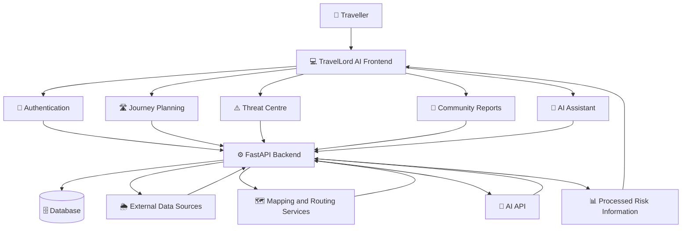

<div align="center">

# 🌍 TravelLord AI

### Your Intelligent Travel Risk Awareness Companion

**Know the risks. Plan your journey. Travel with awareness.**

A traveller-focused platform that brings together location-based hazard awareness, route risk information, official alerts, and community-reported incidents to help people make more informed travel decisions across India.

<p>
  
  
  
  
</p>

<p>
  <b>🛣️ Route Awareness</b> &nbsp; • &nbsp;
  <b>⚠️ Hazard Reporting</b> &nbsp; • &nbsp;
  <b>🗺️ Interactive Maps</b> &nbsp; • &nbsp;
  <b>🤖 AI Assistance</b>
</p>

</div>

---

## 📌 Table of Contents

- [🌟 About the Project](#-about-the-project)
- [❗ Problem Statement](#-problem-statement)
- [💡 Our Solution](#-our-solution)
- [✨ Key Features](#-key-features)
- [🧠 AI Innovation](#-ai-innovation)
- [🏗️ System Architecture](#️-system-architecture)
- [🛠️ Technology Stack](#️-technology-stack)
- [📂 Project Structure](#-project-structure)
- [⚙️ Installation and Setup](#️-installation-and-setup)
- [🔐 Environment Configuration](#-environment-configuration)
- [🔌 API Overview](#-api-overview)
- [🗄️ Database](#️-database)
- [🧪 Testing](#-testing)
- [🛡️ Safety, Privacy and Data Transparency](#️-safety-privacy-and-data-transparency)
- [🚀 Future Enhancements](#-future-enhancements)
- [🤝 Contributing](#-contributing)
- [📄 License](#-license)

---

## 🌟 About the Project

**TravelLord AI** is a travel-risk awareness platform designed to help travellers understand potential hazards associated with their journeys and destinations.

Information about road blockages, extreme weather alerts, landslides, flooding, wildlife movement, accidents, and local disturbances can be distributed across multiple sources. Finding relevant information at the right time can be difficult, especially when travelling through unfamiliar locations.

TravelLord AI aims to bring relevant risk information into one accessible platform, combining interactive maps, journey planning, official alerts, community reports, and AI-assisted information access.

🎯 **Our mission:** Make travel-related risk information easier to discover, understand, and share.

> TravelLord AI supports informed decision-making. It does not guarantee a risk-free journey or replace official emergency instructions.

---

## ❗ Problem Statement

Travellers often encounter difficulties when trying to identify potential risks along their routes or at their destinations.

- 🌧️ **Scattered information:** Weather warnings, road updates, and local reports are available across different sources.
- 🛣️ **Limited route awareness:** Travellers may not know about reported hazards along their intended journey.
- 📍 **Unfamiliar locations:** Visitors and regular travellers alike may lack reliable local risk information.
- 👥 **Disconnected communities:** People who encounter hazards need a way to share useful information with other travellers.
- ⏱️ **Information accessibility:** Understanding which alerts are relevant to a location can take time.

The result is a need for a centralized, traveller-oriented platform that makes available risk information easier to access and interpret.

---

## 💡 Our Solution

TravelLord AI brings together multiple travel-awareness capabilities through a unified interface.

| Challenge | TravelLord AI approach |
|---|---|
| Risk information is scattered | Centralized risk-awareness interface |
| Hazards may affect a journey | Route-related risk information |
| Travellers need local updates | Location-based incident discovery |
| People encounter new hazards | Community hazard reporting |
| Official warnings need visibility | Official alert and source information |
| Information can be difficult to interpret | AI-assisted explanations and guidance |

The platform emphasizes **awareness, transparency, and useful context**, rather than making unsupported predictions about future hazards.

---

## ✨ Key Features

### 🗺️ 1. Journey Planning and Route Awareness

- Explore journeys between selected locations.
- View routes on an interactive map.
- Present available risk information relevant to the journey.
- Help travellers identify reported hazards and official alerts where data is available.
- Access saved journeys and travel-related information.

### ⚠️ 2. Threat Centre

A centralized interface for exploring available hazard and incident information.

- Geotechnical hazards, including reported landslides and flooding.
- Wildlife-related incidents and movement reports.
- Road incidents, blockages, and traffic-related disruptions.
- Social disturbances and other relevant local incidents.
- Risk categories, source details, and available timestamps.

### 👥 3. Community Hazard Reporting

Enable users to contribute information about hazards they encounter.

- Submit a hazard report with relevant details.
- Associate reports with a location and category.
- Share reports for wider traveller awareness.
- Track personal contributions.
- Support review and verification workflows where implemented.

**Important:** A community-submitted report should not automatically be presented as an officially verified incident.

### 🌦️ 4. Official Alerts and Information Sources

Bring relevant information from supported external sources into a single interface.

Potential source categories include:

- Weather information and alerts.
- Flood-related information.
- Geological hazard information.
- Traffic and road updates.
- Other permitted and relevant public information.

Source availability depends on the actual integration, service availability, API restrictions, and geographic coverage.

### 🤖 5. AI Travel Assistant

The AI Assistant is designed to help users understand information available through the platform.

It can support tasks such as:

- Explaining hazard categories and risk information.
- Helping users interpret available route information.
- Answering travel-awareness questions.
- Providing guidance based on available platform context.

Where configured, the assistant can use the Groq API.

AI-generated explanations should remain grounded in available evidence and must not be treated as confirmation of an incident or a guarantee of safety.

### 🔔 6. Notifications and Awareness

Where implemented, notifications can help users access relevant updates, report activity, and travel-related information.

### 📚 7. Travel Safety Resources

Additional platform modules support traveller awareness through:

- Hazard guides.
- Emergency guidance.
- Travel information and discovery.
- Travel packs and saved information.
- Source transparency.
- User profiles and preferences.

### 🛡️ 8. Administration and Trust

Administrative capabilities can support the management and review of reports, source information, and platform activity, subject to implemented access controls.

---

## 🧠 AI Innovation

TravelLord AI focuses on making risk information more accessible and understandable through AI-assisted interaction.

### How AI contributes

1. **Context-aware assistance:** Help users interpret available platform information.
2. **Information explanation:** Present complex hazard details in clearer language.
3. **Traveller-focused responses:** Organize answers around locations, journeys, and reported risks.
4. **Evidence-aware communication:** Distinguish available information from missing or uncertain evidence.

### Our design principle

> AI should help people understand available evidence — not invent hazards, claim certainty, or replace official safety decisions.

TravelLord AI is designed as an **awareness platform**, not a predictive hazard forecasting system.

---

## 🏗️ System Architecture

The following diagram illustrates the intended high-level architecture. Exact data flows depend on the integrations enabled in the deployed application.



### Architecture overview

| Layer | Responsibility |
|---|---|
| Frontend | User interface, maps, navigation, and interactions |
| Backend | API endpoints, application logic, and integrations |
| Database | Persistent application data |
| Mapping services | Map data, geocoding, and route retrieval |
| External sources | Available weather, alert, and incident information |
| AI service | AI-assisted responses when configured |

---

## 🛠️ Technology Stack

The project uses the following technologies in its current architecture.

<table>
  <tr>
    <th>Category</th>
    <th>Technology</th>
  </tr>
  <tr>
    <td>🎨 Frontend</td>
    <td>React, TypeScript, Vite</td>
  </tr>
  <tr>
    <td>💅 Styling</td>
    <td>Tailwind CSS</td>
  </tr>
  <tr>
    <td>🧭 Navigation</td>
    <td>React Router</td>
  </tr>
  <tr>
    <td>🗺️ Maps</td>
    <td>Leaflet, React-Leaflet, OpenStreetMap</td>
  </tr>
  <tr>
    <td>⚙️ Backend</td>
    <td>Python, FastAPI, Pydantic</td>
  </tr>
  <tr>
    <td>🗄️ Database</td>
    <td>SQLite for local development, SQLAlchemy</td>
  </tr>
  <tr>
    <td>🌐 Routing and geocoding</td>
    <td>OSRM, OpenStreetMap Nominatim</td>
  </tr>
  <tr>
    <td>🌦️ Weather integration</td>
    <td>Open-Meteo and configured data-source adapters</td>
  </tr>
  <tr>
    <td>🤖 AI integration</td>
    <td>Groq API, when configured</td>
  </tr>
</table>

---

## 📂 Project Structure

The repository is organized into frontend and backend components. The exact files may differ as development progresses.

```text
TravelLordAI-2026/
│
├── frontend/                  # React application
│   ├── src/
│   │   ├── components/        # Shared UI components
│   │   ├── pages/             # Application pages
│   │   ├── services/          # API integration
│   │   └── ...                # Other frontend modules
│   ├── package.json
│   └── vite.config.ts
│
├── backend/                   # FastAPI application
│   ├── app/
│   │   ├── api/               # API endpoints
│   │   ├── models/            # Data models
│   │   ├── schemas/           # Request and response schemas
│   │   └── ...                # Other backend modules
│   └── ...
│
├── docs/                      # Project documentation
├── .gitignore
└── README.md
```

> This is a representative structure. Use the actual directory and file names in your local repository when following the setup instructions.

---

## ⚙️ Installation and Setup

Follow these steps to run the project locally.

### Prerequisites

Install the following:

- [Git](https://git-scm.com/)
- [Python](https://www.python.org/downloads/)
- [Node.js](https://nodejs.org/) with npm

Check your installations:

```bash
git --version
python --version
node --version
npm --version
```

### 1. Clone the repository

```bash
git clone https://github.com/devakashlakshmanan/TravelLordAI-2026.git
```

Navigate into the project:

```bash
cd TravelLordAI-2026
```

### 2. Install frontend dependencies

Open a terminal in the frontend directory:

```bash
cd frontend
npm install
```

Start the frontend development server:

```bash
npm run dev
```

Vite will display the local URL in your terminal, commonly:

```text
http://localhost:5173
```

Keep this terminal running.

### 3. Install backend dependencies

Open a second terminal and navigate to the backend directory:

```bash
cd backend
```

Create a Python virtual environment:

**Windows**

```bash
python -m venv .venv
.venv\Scripts\activate
```

**Linux / macOS**

```bash
python3 -m venv .venv
source .venv/bin/activate
```

Install dependencies using the repository's dependency file:

```bash
pip install -r requirements.txt
```

If the dependency file is located elsewhere, use its actual path. If the project uses `pyproject.toml` instead, follow its documented installation instructions.

### 4. Configure environment variables

Create the appropriate `.env` file using the project's environment configuration example, if available.

Do not commit secrets to GitHub.

### 5. Start the backend

Use the FastAPI application module defined in your repository. For example, if the application object is `app` inside `app/main.py`, run:

```bash
uvicorn app.main:app --reload
```

The API will commonly be available at:

```text
http://127.0.0.1:8000
```

FastAPI interactive API documentation is commonly available at:

```text
http://127.0.0.1:8000/docs
```

**Note:** Adjust the startup command to match the actual Python module and application object in your project.

---

## 🔐 Environment Configuration

Keep API keys and other secrets on the backend.

Example configuration:

```env
# Application
APP_ENV=development

# Database
DATABASE_URL=sqlite+aiosqlite:///./travellord.db

# AI Assistant — optional
GROQ_API_KEY=your_groq_api_key_here
```

These are example values, not a guarantee that every variable name matches the current implementation. Check the backend configuration code before using them.

### 🔒 Security checklist

- Keep `.env` files out of version control.
- Add `.env` and other secret files to `.gitignore`.
- Never expose private API keys in frontend environment variables.
- Validate and sanitize user-submitted data.
- Enforce authorization on protected API endpoints.
- Ensure users can access only data permitted by their account role.
- Apply appropriate rate limits and error handling.

---

## 🔌 API Overview

The FastAPI backend provides the application programming interface for supported features.

Depending on the implementation, API groups may include:

| API area | Purpose |
|---|---|
| Authentication | Registration, login, and account management |
| Journey planning | Route and journey-related requests |
| Risk information | Access available hazard and incident data |
| Community reports | Submit and retrieve reports |
| Notifications | Retrieve relevant updates |
| AI Assistant | Submit prompts for AI-assisted responses |
| Administration | Authorized management operations |

### Explore the API

Once the backend is running, visit:

- **Swagger UI:** `http://127.0.0.1:8000/docs`
- **ReDoc:** `http://127.0.0.1:8000/redoc`

These are the standard FastAPI documentation routes unless the application configuration changes them.

Use the interactive API documentation to inspect actual endpoints, request schemas, authentication requirements, and response formats.

---

## 🗄️ Database

TravelLord AI uses SQLite for local development in its current configuration.

The database can store application data such as:

- User accounts and preferences.
- Journey-related information.
- Hazard and incident records.
- Community reports.
- Notifications and contributions.

The exact tables and relationships are determined by the implemented database models.

### Database considerations

- Protect user credentials and personal information.
- Use appropriate database constraints and validation.
- Maintain backups for important data.
- Separate test data from production data.
- Consider PostgreSQL with PostGIS when production-scale geospatial querying is required.

---

## 🧪 Testing

Test the application before deployment.

### Frontend checks

```bash
cd frontend
npm run build
```

Run the repository's configured linting or test commands if available:

```bash
npm run lint
npm run test
```

These commands depend on the scripts defined in `package.json`.

### Backend checks

Activate the Python virtual environment, install dependencies, and run the configured test suite. For a project using pytest:

```bash
pytest
```

### Functional testing checklist

- [ ] Registration and login work correctly.
- [ ] Protected pages are inaccessible to unauthorized users.
- [ ] Journey planning handles valid and invalid inputs.
- [ ] Maps display available routes correctly.
- [ ] Risk information displays appropriate source and timestamp details.
- [ ] Community reports are saved and retrieved correctly.
- [ ] Report verification status is displayed accurately.
- [ ] The AI Assistant handles unavailable data and API failures safely.
- [ ] Navigation menus work with mouse, keyboard, and touch.
- [ ] Pages remain usable on mobile and desktop screens.
- [ ] Backend authorization prevents unauthorized data access.
- [ ] Loading, empty, and error states are handled clearly.

> The checklist describes recommended verification steps. It does not imply that every test has already passed.

---

## 🛡️ Safety, Privacy and Data Transparency

TravelLord AI is intended to improve access to travel-related information, not replace official authorities or emergency services.

### 📡 Source transparency

Where possible, information should communicate:

- Its source.
- Its category and location.
- Its reporting or update time.
- Its verification status.
- Any known limitations.

### ⚠️ Different information types

The application should distinguish between:

- **Official alerts:** Information published by an identified authority.
- **Community reports:** Information submitted by platform users.
- **Sample or demonstration data:** Records included for development or testing.
- **External service data:** Information returned by configured third-party services.

Do not present sample records as live incidents or unverified reports as confirmed facts.

### 🔐 Privacy

The application should collect only the data necessary for its functionality, protect user information, and restrict account-specific information to authorized users.

### 🚨 Emergency awareness

For urgent situations, follow instructions from relevant authorities and contact the appropriate local emergency service. Do not rely exclusively on this platform for emergency decisions.

---

## 🚀 Future Enhancements

Potential future improvements include:

- 🌏 Broader geographic coverage across India.
- 📍 More consistent location-based incident discovery.
- 🔄 Improved official-source integration and freshness tracking.
- 👥 Stronger community-report moderation and verification.
- 🔔 More reliable, relevant notifications.
- ♿ Improved accessibility and keyboard navigation.
- 📱 Further mobile usability improvements.
- 🧪 Expanded automated testing and integration monitoring.
- 📊 Better source coverage and data-quality reporting.
- 🔐 Additional production security and operational monitoring.

These are possible enhancements and should not be interpreted as features already completed.

---

## 🤝 Contributing

Contributions that improve usability, reliability, accessibility, security, and source transparency are welcome.

1. Fork the repository.
2. Create a feature branch.
3. Make focused changes.
4. Test the affected functionality.
5. Submit a pull request with a clear description.

Example:

```bash
git checkout -b feature/your-feature-name
git add .
git commit -m "Improve travel risk awareness"
git push origin feature/your-feature-name
```

Please avoid committing credentials, personal data, local database files containing private information, or unrelated generated files.

---

## 📄 License

Add the project's chosen open-source license to the repository before publishing it as an open-source project.

Until a license is specified, the repository should not be assumed to grant unrestricted permission to reuse, modify, or redistribute its contents.

---

<div align="center">

### 🌍 Travel Smarter. Stay Informed. Travel Aware.

**TravelLord AI — Making travel-risk information more accessible.**

<sub>Built as a technology project focused on traveller awareness, accessible information, and responsible AI assistance.</sub>

</div>
