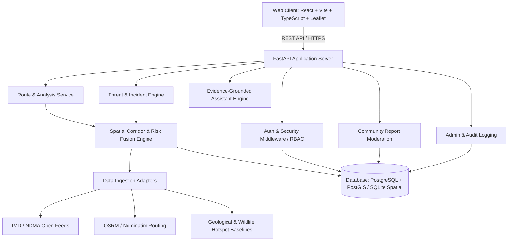

# TravelLord AI — System Architecture

## 1. Architectural Principles
1. **Evidence-Driven Separation**: Raw observations, official alerts, citizen reports, and model predictions are stored as distinct entities.
2. **Modular Monolith**: Clean layer boundaries (API, Domain Services, Repositories, Ingestion Adapters) without microservice overhead.
3. **Spatial Decoupling**: Spatial calculations use PostGIS geometric operations in production with pure Python geodesic (Haversine/Shapely) fallbacks for test environments.
4. **Resilient Ingestion**: Adapters fetch and normalize external feeds asynchronously with failure isolation and backoff retries.

## 2. Component Structure
- **Frontend (`/frontend`)**:
  - Vite + React 18 + TypeScript.
  - Tailwind CSS for design system tokens (Midnight Navy, Travel Teal, Fresh Mint, Alert Red).
  - Leaflet & React-Leaflet for interactive map visualization.
  - Lucide React icons, accessible dialogs, and responsive viewport layouts.
- **Backend (`/backend`)**:
  - FastAPI with asynchronous route handlers.
  - SQLAlchemy 2.0 async ORM with Pydantic v2 schemas.
  - Spatial risk fusion engine combining threat buffers across route waypoints.
  - Multi-tier authentication (JWT + secure cookies + RBAC).
- **Data & Ingestion Pipeline (`/backend/app/integrations`)**:
  - Dedicated adapters for IMD weather alerts, OpenStreetMap/OSRM routing, Geological Survey of India landslide baselines, Wildlife corridor advisories, and civic disruption feeds.

## 3. Deployment Topology
- **Web Layer**: Static Vite bundle served via Nginx or managed edge CDN.
- **API Server**: Uvicorn ASGI processes behind reverse proxy with HTTPS.
- **Data Layer**: Managed PostgreSQL 15+ with PostGIS 3.3+ spatial extension enabled.
